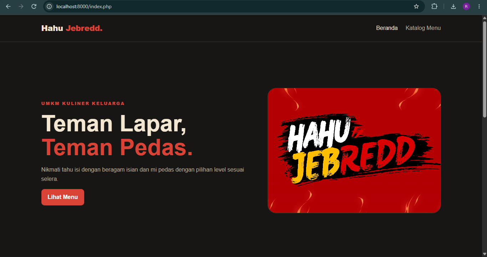
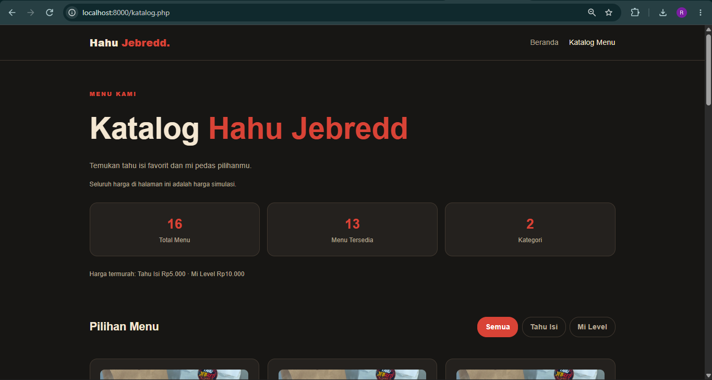

#  Hahu Jebredd - UTS-pemweb-025a00231002

1. Identitas Mahasiswa
    **Nama:** Muhammad Afarel Ristian
    **NIM:** 025A00231002
    **Program Studi:** Informatika
    **Mata Kuliah:** Pemrograman Web
    **Universitas:** Universitas Tiga Serangkai

2. Deskripsi Proyek
    Hahu Jebredd adalah website katalog menu untuk usaha kuliner keluarga yang menjual tahu dengan isian pedas dan mi pedas. Pengunjung dapat melihat daftar menu yang bisa difilter berdasarkan kategori. Website bersifat tampilan saja (tanpa pemesanan). Seluruh harga adalah harga simulasi. Produk yang ada di website ini merupakan produk asli keluarga yang sedang berjalan sekarang
    
3. Cara menjalankan di localhost
    - pastikan laragon sudah terpasang
    - klik start all
    - buka vs code 
    - folder yang akan dijalankan
    - klik ctrl + ` untuk membuka terminal lalu ketikkan : php -S localhost:8000
    - ctrl + klik pada link yang muncul

4. Daftar fitur
    - index.php merupakan beranda website yang berisi tentang pengenalan usaha Hahu Jebredd
    - katalog.php menampilkan seluruh menu yang tersedia 
    - data.php digunakan untuk menyimpan data menu
    - functions.php digunakan untuk pengolahan data dan format tampilan
    - style.css digunakan untuk mengatur desain dan tata letak website
    - assets berisikan foto - foto yang dpakai pada website
    - screenshoots berisi tangkapan layar website yang meliputi beranda dan katalog 

5. Fungsi Array Bawaan PHP
    - count() — menghitung jumlah menu dan kategori.
    - array_column() — mengambil kolom kategori dan harga dari data menu.
    - array_unique() — membuat daftar kategori tanpa duplikat.
    - array_values() — merapikan ulang indeks array.
    - array_filter() — menyaring menu berdasarkan kategori dan ketersediaan.
    - in_array() — memvalidasi nilai filter kategori dari URL.
    - range() — membuat deret level 1 sampai 10 untuk menu Mie Level.
    - min() — mencari harga termurah.
    - implode() — menggabungkan label harga termurah menjadi satu teks.

6. Tangkapan Layar
     

7. Referensi dan Penggunaan AI
    - PHP Manual: https://www.php.net/manual/en/
    - MDN Web Docs: https://developer.mozilla.org/

    Pada website ini saya menggunakan claude sebagai media untuk belajar saya. Misal pada suatu kondisi saya tidak mengetahui fungsi dari sebuah kode, saya tanyakan kepada AI untuk menjelaskan. Selain itu saya juga sangat dibantu oleh teman teman saya pada saat mengerjakan tugas ini bersama.